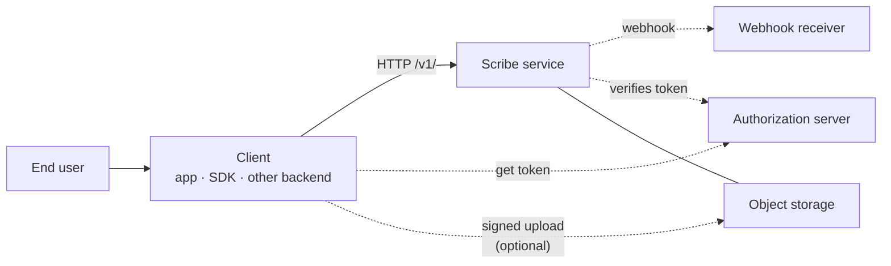
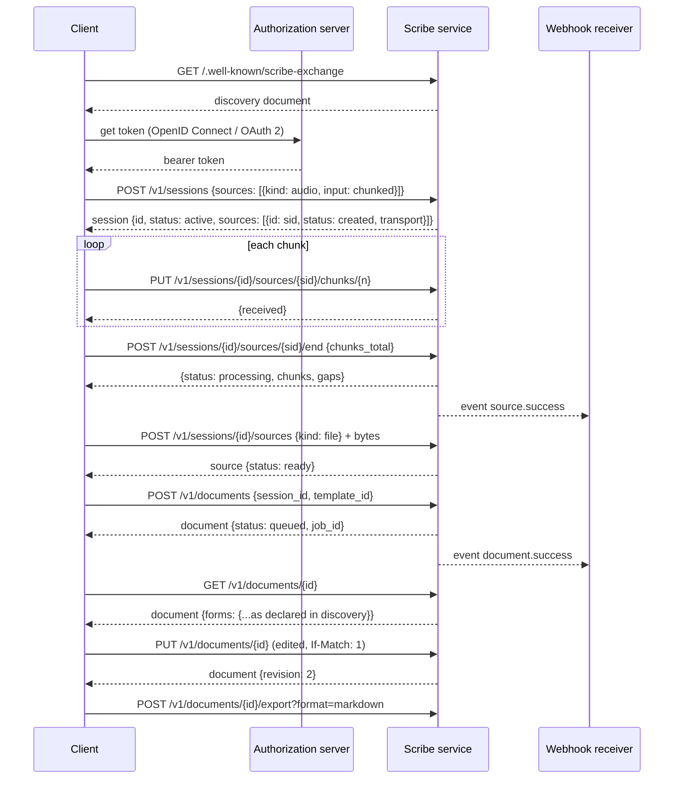
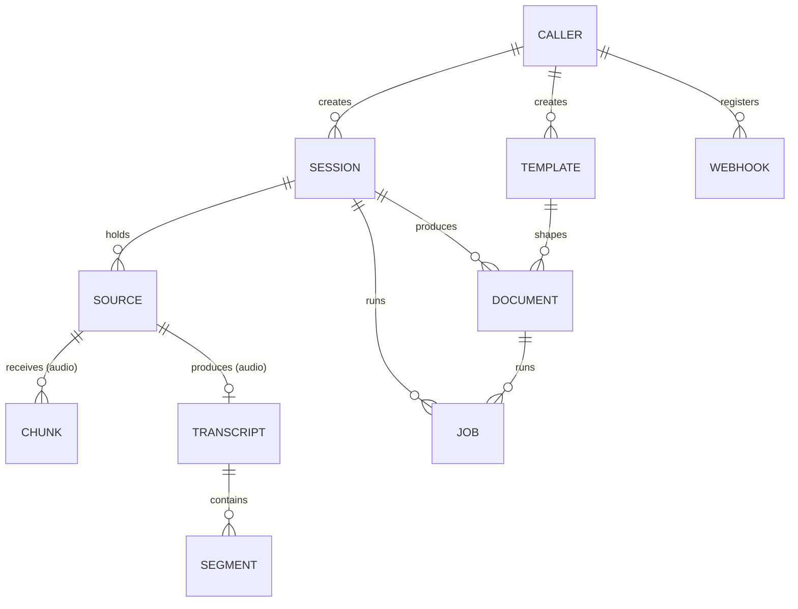

# 2. Architecture

**Scribe Exchange Protocol v0.1 (draft)**

---

## 2.1 Actors

| Actor | What it does | Required? |
|---|---|---|
| **End user** | Speaks, reviews the document, edits it. Never talks to the service directly; goes through a client. | — |
| **Client** | Calls the service. Three shapes: a user-facing app (web, mobile, desktop), an SDK embedded in someone else's app, or another backend (server-to-server). | Yes |
| **Scribe service** | Implements this protocol: stores sessions, transcribes, structures, keeps documents, emits events. | Yes |
| **Authorization server** | Where clients get bearer tokens: an OpenID Connect / OAuth 2 server the deployment runs or trusts (Keycloak, Google Workspace, Microsoft Entra, or one built into the service). Discovery names it. | Yes |
| **Webhook receiver** | A URL on the client's side that the service calls when something happens. | Optional |
| **Object storage** | A file store (S3, GCS, Azure Blob, MinIO) the service may let clients upload to directly through signed URLs. | Optional |

## 2.2 Integration patterns

**A. User-facing app.** A person signs in at the authorization server named in discovery and the app receives a short-lived bearer token (a token sent in the `Authorization` header, chapter 5). The app records audio, sends chunks as they are made, ends the session, picks a template, shows the document, saves edits, exports.

**B. Server-to-server.** Another backend obtains a token for itself from the authorization server (the OAuth 2 *client credentials* flow: no person involved) and sends it the same way. It creates a session with one audio source of `input: file`, uploads the recording, and either polls the job or receives a webhook. Same endpoints, same objects; only the credential differs.

**C. Embedded SDK.** The client is a library inside a third party's web page or app (for example, a scribe panel inside an electronic record system). It behaves like pattern A; results reach the host page through the SDK's own events, not through this protocol.

A service MUST support A and B. C is a client-side matter; the service sees it as A.

## 2.3 The flow

Steps in plain words:

1. **Discover.** Read what the service supports. Cache it.
2. **Get a token** from the authorization server that discovery names. People sign in there; servers use client credentials. Send it as `Authorization: Bearer`.
3. **Create a session**, optionally with a first source in the same call. For an audio source, say how audio will arrive (`chunked` or `file`) and which languages are spoken; the service replies with the **transport**: exactly where and how to send it.
4. **Send audio.** Chunks are numbered from 0. The service may start transcribing as chunks arrive. **Add other sources** at any time: a note, a file, a reference to earlier work, a second recording.
5. **End the recording.** The service says which chunks it has and which are missing. The client fills gaps and ends again if needed. The audio source becomes `processing`, then `success` when its transcript is ready. The session itself stays `active`.
6. **Generate documents.** One call per document: a session id and a template id. The same template may be used any number of times on the same session. Each call returns a job; the client polls or, if it has a server, waits for a webhook.
7. **Read, edit, export.** A document holds its current content and a `revision` number. Saving sends the revision that was edited; if someone else saved in between, the service answers `409` and the client decides what to do. Which forms a document has, and which export formats exist, the service declared in discovery.

## 2.4 Objects and how they relate

One line each:

- A **caller** (the subject of the bearer token) creates sessions, templates and webhooks. Which other callers may see them is the service's policy, not the protocol's; the protocol only promises that a caller sees what it created.
- A **session** is a folder: it holds sources and produces documents. It is `active` until its owner archives it.
- A **source** is one thing in the folder: `audio` (a recording, which produces a transcript), `text`, `file` or `reference`. Any number, added at any time, each with an id so documents can say what they used.
- A **transcript** is an ordered list of segments, made from one audio source.
- A **document** is made from one session and one template. It holds its **current content** and a `revision` number that rises on every save. The protocol does not require the service to keep old revisions; a `document.saved` event fires on every save, so a client or plugin that wants history can keep it. A service that does keep history says so in discovery (`capabilities.document_history`).
- A **job** belongs to the session or document whose work it does.
- An **event** records a change to any of the above and is delivered to webhooks.

## 2.5 Status vocabulary

One set of words, used everywhere:

| Object | States |
|---|---|
| Session | `active` \| `archived` (no outcome; a folder is open or it is not) |
| Audio source | `created` → `recording` → `processing` → `success` \| `failed` \| `cancelled` |
| Other sources | `ready` \| `failed` |
| Document | `queued` → `generating` → `success` \| `failed` |
| Job | `queued` → `running` → `success` \| `failed` |

Times such as when recording started and ended are fields on the audio source (`recording_started_at`, `recording_ended_at`), not states. An audio source that succeeded with problems stays `success` and carries `warnings[]` (closed list, chapter 6): a chunk skipped for bad audio, the recording ended by the service because the maximum length was reached (`max_duration_reached`) or because no chunk arrived for the inactivity time (`auto_ended`). In every such case the service processes what it has.

`cancelled` is for a recording that ended **without** a transcript, with a `cancel_reason`: `client` or `no_audio` (nothing ever arrived and the inactivity time passed). There is no "expired" state anywhere; a session never times out.

## 2.6 Where profiles fit

A **profile** is a named add-on for one field. It may add: template packs, extra fields on base objects (always optional), extra objects and endpoints under `/v1/profiles/{name}/`, extra event types, and strict output schemas for its templates. It may not change or remove anything in the base. The discovery document lists the profiles a service has installed. Chapter 16 has the rules.

---

**Previous:** [1. Introduction](./01-introduction.md) · **Next:** [3. Versioning](./03-versioning.md)
