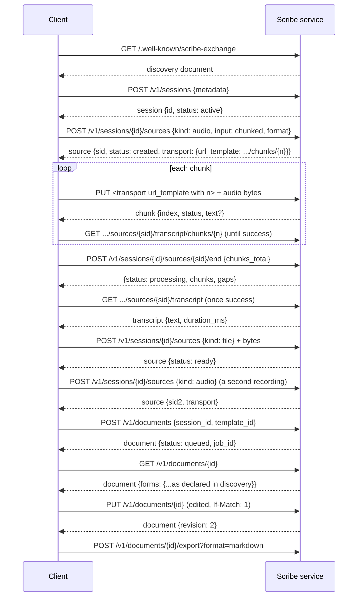
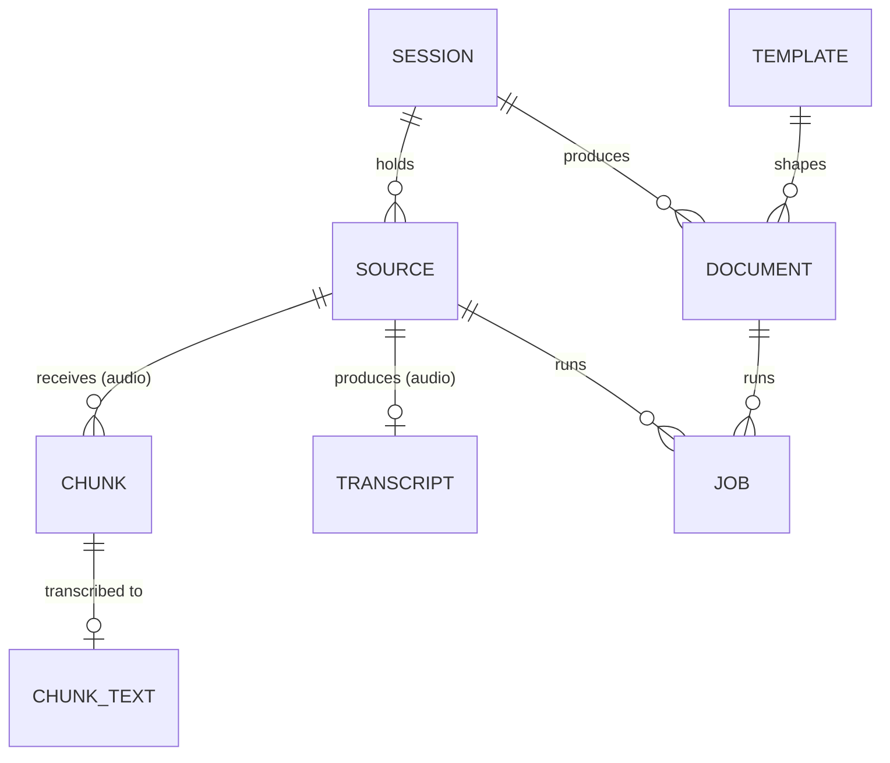

# 2. Architecture

**Scribe Exchange Protocol v0.1 (draft)**

---

## 2.1 Two parties

| Party | Role |
|---|---|
| **Client** | Sends requests. |
| **Scribe service** | Answers them: stores sessions and sources, transcribes audio, writes documents. |

The protocol describes what passes between these two. Two further parties appear exactly as far as the wire shows them:

| | Where it appears |
|---|---|
| **Authorization server** | Named in discovery when the service requires authentication (chapter 5). The client obtains tokens from it by standard OpenID Connect / OAuth 2. |
| **Object storage** | Appears only as the upload URL in a source's `transport`, when the service hands out pre-signed URLs instead of hosting the upload itself (chapters 6, 7). |

## 2.2 The flow

1. **Discover.** Read what the service supports; cache it.
2. **Authenticate** when discovery asks for it (chapter 5); send `Authorization: Bearer` from then on.
3. **Create a session.** It starts empty and `active`.
4. **Start a recording** by adding an audio source. It comes back with a **transport**: exactly where and how to send the audio.
5. **Send audio** as numbered chunks, or as one file. The service may transcribe as chunks arrive.
6. **End the recording.** The service reports which chunks it has and which are missing; the client fills the gaps and ends again. The audio source becomes `processing`, then `success` when its transcript is ready. The session stays `active`.
7. **Add more sources** at any time while the session is active: text, a file, a reference to earlier work, another recording (steps 4–6 again).
8. **Generate documents.** One call per document: a session id and a template id. The same template may be used any number of times. Each call returns a job; the client polls it until it is done (chapter 11).
9. **Read, edit, export.** A document holds its current content and a `revision`. Saving sends the revision that was edited; a stale one gets `409`. Discovery declares which forms and export formats exist.

## 2.3 Objects

- A **session** is a folder: it holds sources and produces documents. It is `active` until archived.
- A **source** is one thing in the folder: `audio` (a recording, which produces a transcript), `text`, `file` or `reference`. Any number, added at any time, each with an id so a document can say what it used.
- A **transcript** is the text of one audio source: chunk by chunk while recording, whole once the source is `success`.
- A **template** is the recipe for a document.
- A **document** is made from one session and one template. It holds its current content and a `revision` number. A service that also keeps earlier revisions says so in discovery (`document_history`).
- A **job** is background work on a session or a document; polling it is how a client learns the work is done.

The protocol defines these objects and the operations on them. Access rules are the service's.

## 2.4 Status vocabulary

One set of words, used everywhere:

| Object | States |
|---|---|
| Session | `active` \| `archived` |
| Audio source | `created` → `recording` → `processing` → `success` \| `failed` \| `cancelled` |
| Other sources | `ready` \| `failed` |
| Document | `queued` → `generating` → `success` \| `failed` |
| Job | `queued` → `running` → `success` \| `failed` |

Times are fields (`recording_started_at`, `recording_ended_at`). A thing that succeeded with problems stays `success` and carries `warnings[]` (closed list, chapter 6). `cancelled` is a recording that ended without a transcript and carries a `cancel_reason`. A session stays `active` for as long as its owner wants.

## 2.5 Profiles

A **profile** is a named add-on for one field. It may add template packs, optional fields on base objects, objects and endpoints under `/v1/profiles/{name}/`, event types, and strict output schemas for its templates. The base stays as it is. Discovery lists the installed profiles. Chapter 15 has the rules.

---

**Previous:** [1. Introduction](./01-introduction.md) · **Next:** [3. Versioning](./03-versioning.md)
