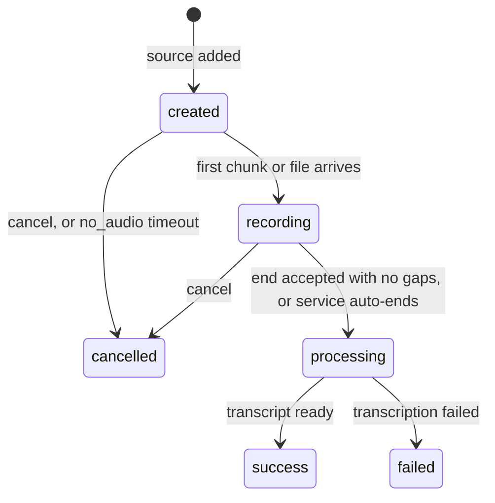

# 6. Sessions and sources

**Scribe Exchange Protocol v0.1 (draft)** · Schemas: [`session.schema.json`](../schemas/session.schema.json), [`source.schema.json`](../schemas/source.schema.json), [`session-create-request.schema.json`](../schemas/session-create-request.schema.json), [`source-create-request.schema.json`](../schemas/source-create-request.schema.json), [`source-end-response.schema.json`](../schemas/source-end-response.schema.json)

---

## 6.1 The idea

A **session** is a folder. You open it and, over minutes or days, you put **sources** into it: a recording, a second recording, a pasted note, a PDF, a pointer to an earlier session. Whenever you like you ask for a **document** (chapter 10); the writer reads the sources that are ready at that moment.

The session itself does no work. Work happens on sources (a recording is transcribed) and on documents (a template is applied). So the session has almost no state; sources and documents carry the states.

Voice is the most common source and the only one with a real lifecycle. It is not special otherwise: a session with no audio at all is a normal session.

## 6.2 The session object

```json
{
  "id": "01J9ZM1A2B3C4D5E6F7G8H9J0K",
  "status": "active",
  "metadata": { "visit_ref": "V-2026-1042" },
  "created_at": "2026-10-22T06:10:00.000Z",
  "archived_at": null,
  "sources": [ { "id": "01J9ZN7B…", "kind": "audio", "status": "success", "label": "consultation", "…": "…" } ],
  "document_ids": ["01J9ZP3C…"]
}
```

| Field | Type | Meaning |
|---|---|---|
| `id` | ULID | |
| `status` | string | Closed list: `active` (sources and documents may be added), `archived` (read-only). No outcome, no timeout: a session stays `active` as long as its owner wants. |
| `metadata` | object | Client pass-through, returned unchanged everywhere the session appears, including in events. Max 4 KB. The service MUST NOT interpret it. |
| `created_at` | timestamp | |
| `archived_at` | timestamp \| null | |
| `sources` | Source[] | Every source in the session, in creation order (6.4). |
| `document_ids` | ULID[] | Documents made from this session (chapter 10). |

## 6.3 Session endpoints

### Create

```http
POST /v1/sessions
Content-Type: application/json

{
  "metadata": { "visit_ref": "V-2026-1042" },
  "sources": [ { "kind": "audio", "input": "chunked", "language_hints": ["hi", "en"] } ]
}
```

Both fields optional. `sources` is a shortcut: each entry is a source-create request (6.5) and is created with the session, so a recording app starts a session and its recording in one round trip. Response `201` with the session; an audio source in it carries its `transport` ready to use.

### Get, list

```http
GET /v1/sessions/{id}
GET /v1/sessions?status=active&created_after=2026-10-01T00:00:00Z&limit=50&cursor=…
```

List returns the sessions visible to the caller (at least the ones it created; anything wider is the service's policy). Filters: `status`, `created_after`, `created_before`. Pagination: `limit` (default 50, max 200) and an opaque `cursor`; the response carries `next_cursor` or `null`. `GET /v1/sessions/{id}` includes `sources`; the list omits them (`source_count` instead).

### Archive

```http
POST /v1/sessions/{id}/archive
```

Status becomes `archived`; `archived_at` set. No new sources or documents may be added; everything stays readable. Audio sources still `recording` are ended by the service as if `end` had been called (6.8). `200` with the session. Already archived: `200`, no change.

### Delete

```http
DELETE /v1/sessions/{id}
```

Removes the session and everything in it: sources and their audio, transcripts, documents. Chapter 13 says what "removed" means. `202` with a job id, or `204` if done at once.

## 6.4 The source object

A source is one thing put into a session. Every source has the common fields below; `audio` adds its own (6.7).

```json
{
  "id": "01J9ZN7B8C9D0E1F2G3H4J5K6M",
  "kind": "file",
  "status": "ready",
  "label": "referral letter",
  "created_at": "2026-10-22T06:05:00.000Z",
  "file": { "name": "referral.pdf", "content_type": "application/pdf", "size_bytes": 184233 }
}
```

| Field | Type | Meaning |
|---|---|---|
| `id` | ULID | |
| `kind` | string | **Open list.** This version defines `audio`, `text`, `file`, `reference`. A service accepts the kinds it lists in discovery (`capabilities.sources.kinds`); clients MUST ignore kinds they do not know. |
| `status` | string | Closed list: `ready`, `failed`, and for `audio` also `created`, `recording`, `processing`, `success`, `cancelled` (6.7). |
| `label` | string \| null | Display name chosen by the client ("exam recording", "referral letter"). The only editable field. Not used for generation. |
| `created_at` | timestamp | |
| `text` | string | `text` kind: the text itself. Max length from discovery. |
| `file` | object | `file` kind: `name`, `content_type`, `size_bytes`. The bytes are fetched with `GET …/sources/{id}/content`. |
| `reference` | object | `reference` kind: exactly one of `session_id`, `document_id`, pointing at something the caller may see. |
| *(audio fields)* | | 6.7 |

What a service **does** with a `text`, `file` or `reference` source when writing a document (extract text, pass the PDF to a model that reads PDFs, ignore images) is implementation, not protocol. The protocol records that the source is there.

**Sources are immutable** except `label`. To change one, delete it and add a new one. Reason: a document records which source ids it used (chapter 10); if a source could change underneath, that record would lie.

## 6.5 Source endpoints

### Add

```http
POST /v1/sessions/{id}/sources
```

The body depends on the kind:

| Kind | Request | Result |
|---|---|---|
| `audio` | JSON: `{ "kind": "audio", "input": "chunked" \| "file", "language_hints": [...], "stt_model": "…", "label": "…" }` | `201`, source in `created` with a `transport` (6.7). No audio bytes in this request. |
| `text` | JSON: `{ "kind": "text", "text": "…", "label": "…" }` | `201`, `ready`. |
| `file` | `multipart/form-data` with a `source` part (JSON: `{ "kind": "file", "label": "…" }`) and a `file` part (the bytes, with its `Content-Type` and filename). Or JSON `{ "kind": "file", "url": "https://…" }` if discovery says `url_fetch: true`. | `201`, `ready` (or `processing` then `ready` for a URL fetch). |
| `reference` | JSON: `{ "kind": "reference", "session_id": "…" }` or `{ "kind": "reference", "document_id": "…" }` | `201`, `ready`. |

Refused with `422 source_limit_reached` when the session already holds the maximum for that kind or in total, and `422 kind_not_supported` for a kind not in discovery. Refused with `409 invalid_state` on an `archived` session.

### List, get, content

```http
GET /v1/sessions/{id}/sources
GET /v1/sessions/{id}/sources/{sid}
GET /v1/sessions/{id}/sources/{sid}/content      (file kind: the bytes; audio kind: the assembled audio, if the service keeps it)
```

### Relabel

```http
PATCH /v1/sessions/{id}/sources/{sid}
{ "label": "exam recording" }
```

The only field that may change. `200` with the source.

### Delete

```http
DELETE /v1/sessions/{id}/sources/{sid}
```

Removes the source and what was derived from it (its transcript, its stored audio). Documents already generated from it are kept; their `inputs` still name the id. `204`. An `audio` source in `recording` is cancelled first.

## 6.6 Limits come from discovery

`capabilities.sources` (chapter 4) says: the total allowed per session, and for each kind whether it is accepted and its own limits (count, size, formats). A client reads these before offering the user a choice. A service MUST accept `audio`.

## 6.7 The audio source

An audio source is one recording. It carries everything to do with getting speech in and text out.

```json
{
  "id": "01J9ZN7B8C9D0E1F2G3H4J5K6M",
  "kind": "audio",
  "status": "recording",
  "label": null,
  "created_at": "2026-10-22T06:10:00.000Z",
  "input": "chunked",
  "language_hints": ["hi", "en"],
  "stt_model": "whisper-large-v3",
  "recording_started_at": "2026-10-22T06:10:04.120Z",
  "recording_ended_at": null,
  "completed_at": null,
  "chunks": { "received": [0, 1, 2, 3], "expected": null, "transcribed": 3 },
  "warnings": [],
  "failure": null,
  "cancel_reason": null,
  "transcript_id": null,
  "transport": { "kind": "http-put", "method": "PUT", "url_template": "https://scribe.example.com/v1/sessions/01J9ZM1A…/sources/01J9ZN7B…/chunks/{n}" }
}
```

| Field | Type | Meaning |
|---|---|---|
| `input` | string | Closed list: `chunked` (numbered chunks as the recording happens), `file` (one complete recording). Fixed at creation. `stream` is reserved for a later version. |
| `language_hints` | string[] | Languages spoken, BCP 47. Empty means "detect". |
| `stt_model` | string | Speech-to-text model id from `models.stt`. Default: the one marked `default`. |
| `recording_started_at` | timestamp \| null | First chunk (or the file) arrived. |
| `recording_ended_at` | timestamp \| null | `end` accepted, or the service ended it. |
| `completed_at` | timestamp \| null | Reached `success`, `failed` or `cancelled`. |
| `chunks` | object | `received`: indexes held, ascending. `expected`: total announced at `end`, or `null`. `transcribed`: how many are transcribed so far. |
| `warnings` | object[] | Problems that did not stop it. `code` (closed list, 6.8), `message`, optional `chunk_index`. |
| `failure` | object \| null | When `failed`: `code` (closed list: `transcription_failed`, `audio_unreadable`, `language_unsupported`, `internal_error`), `message`. |
| `cancel_reason` | string \| null | When `cancelled`: `client` or `no_audio`. |
| `transcript_id` | ULID \| null | Set once the transcript exists (chapter 8). Partial transcripts are readable while `recording`; see 8.4. |
| `transport` | object \| null | Where and how to send the audio (6.9). Present while `created` or `recording`; `null` after. |

### States



| State | Meaning |
|---|---|
| `created` | Exists, nothing received. |
| `recording` | At least one chunk (or the file) received. Chunks are transcribed as they arrive. |
| `processing` | Ended. Remaining chunks transcribed and joined. |
| `success` | Transcript complete. |
| `failed` | Transcription could not finish; `failure` says why. |
| `cancelled` | Ended with no transcript; `cancel_reason` says why. |

## 6.8 Ending a recording

### By the client

```http
POST /v1/sessions/{id}/sources/{sid}/end
{ "chunks_total": 12 }
```

`chunks_total` is optional: how many chunks were sent in all (indexes `0 … chunks_total−1`). With it the service can tell a lost *last* chunk from a finished recording. Without it, the highest index received is treated as the last.

```json
200
{ "status": "recording", "chunks": { "received": [0,1,2,3,4,5,6,7,8,10,11], "expected": 12 }, "gaps": [9] }
```

- `gaps` lists indexes the service does not have below `expected` (or below the highest received).
- Non-empty `gaps`: the source **stays `recording`**. The client re-sends the missing chunks (chapter 7; re-sending is idempotent) and calls `end` again.
- Empty `gaps`: the source moves to `processing`; the response shows that.
- `end` is idempotent on a source already past `recording`.

For `input: file`, `end` is implied by the upload; calling it is harmless.

### By the service

| Situation | Result |
|---|---|
| Recording reached `capabilities.sources.kinds.audio.max_seconds`; later chunks refused with `422 source_not_recording`. | `processing` → `success`, warning `max_duration_reached` |
| No chunk for `capabilities.sources.kinds.audio.inactivity_seconds` while `recording`. | `processing` → `success`, warning `auto_ended` |
| No chunk ever, and `inactivity_seconds` passed while `created`. | `cancelled`, `cancel_reason: no_audio` |
| Session archived while `recording`. | as if `end` were called |

Warning codes (closed list): `max_duration_reached`, `auto_ended`, `chunk_skipped` (a chunk could not be transcribed; `chunk_index`), `chunks_missing` (auto-ended with gaps).

### Cancel

```http
POST /v1/sessions/{id}/sources/{sid}/cancel
```

From `created` or `recording` only; else `409 invalid_state`. Received audio is kept until the source or session is deleted; nothing is transcribed.

## 6.9 Transport

The service tells the client exactly where and how to send the audio. The client MUST use what it is given and MUST NOT build upload URLs itself.

| `kind` | For `input` | Fields | Meaning |
|---|---|---|---|
| `http-put` | `chunked` | `url_template`, `method: PUT` | Replace `{n}` with the chunk index. Raw audio body; `Content-Type` is the format. Through the API. |
| `http-upload` | `file` | `url`, `method: POST` | One request with the whole recording. Through the API. |
| `signed-put` | `chunked`, `file` | `url_template` or `url`, `method: PUT`, `expires_at`, optional `headers` | Direct to object storage with a pre-signed URL. Only when `capabilities.direct_upload` is `true`. |
| `signed-post` | `file` | `url`, `method: POST`, `fields`, `expires_at` | Pre-signed form (S3-style). Only when `direct_upload` is `true`. |
| `websocket` | `stream` | reserved | Not in this version. |

A client MUST be able to handle `http-put` and `http-upload`. Details in chapter 7.

## 6.10 Events

| Event | When |
|---|---|
| `session.created` · `session.archived` · `session.deleted` | |
| `source.added` · `source.deleted` | any kind |
| `source.recording_started` · `source.processing` · `source.success` · `source.failed` · `source.cancelled` | `audio` kind |

Every event carries the session id, the source id where relevant, and the session's `metadata` (chapter 12).

## 6.11 Errors

| Code | HTTP | When |
|---|---|---|
| `session_not_found`, `source_not_found` | 404 | Unknown id, or not visible to this caller. |
| `metadata_too_large` | 400 | > 4 KB. |
| `invalid_source` | 400 | Malformed source request; `language_hint` or `stt_model` not in discovery; `reference` to an unknown object. |
| `kind_not_supported` | 422 | Kind not in `capabilities.sources.kinds`. |
| `source_limit_reached` | 422 | Per-kind or total limit hit. |
| `source_too_large` | 422 | `text` over `max_chars`, `file` over `max_bytes`, or a content type not accepted. |
| `source_not_recording` | 422 | Audio sent to an audio source not in `created` or `recording`. |
| `invalid_state` | 409 | Action not allowed now (add to an archived session, cancel after end). |

## 6.12 Summary of endpoints

| Method | Path | Required? |
|---|---|---|
| POST, GET | `/v1/sessions` | yes |
| GET, DELETE | `/v1/sessions/{id}` | yes |
| POST | `/v1/sessions/{id}/archive` | yes |
| POST, GET | `/v1/sessions/{id}/sources` | yes |
| GET, PATCH, DELETE | `/v1/sessions/{id}/sources/{sid}` | yes |
| GET | `/v1/sessions/{id}/sources/{sid}/content` | yes for `file`; optional for `audio` |
| POST | `/v1/sessions/{id}/sources/{sid}/end`, `…/cancel` | yes (audio) |
| PUT | `/v1/sessions/{id}/sources/{sid}/chunks/{n}` | chapter 7 |
| POST | `/v1/sessions/{id}/sources/{sid}/file` | chapter 7 |

> **[OPEN]** `templates: [id, …]` at session creation to generate documents automatically when sources become ready. Not in this draft.

---

**Previous:** [5. Authentication](./05-authentication.md) · **Next:** [7. Audio input](./07-audio-input.md)
